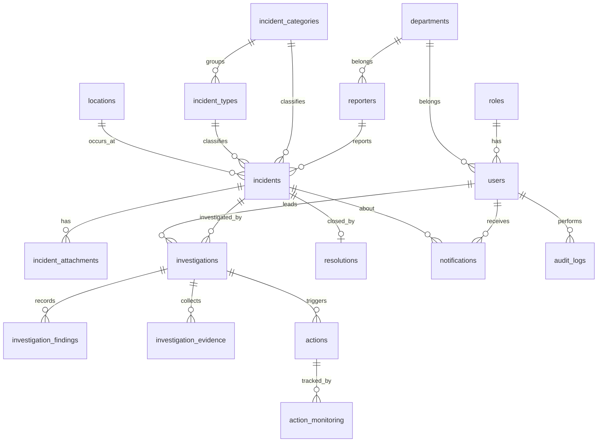

# Database Design (Lab 2) — IndexedDB, 17 object stores

Every store has `id` (PK, auto-increment). `FK` = id of a row in another store. Stores are in 3NF: repeating values live in lookup tables (roles, departments, incident_categories, incident_types, locations) and are referenced by id.

## ERD

## Data dictionary
| Store | Fields (besides id) | Keys / unique / indexes |
|---|---|---|
| roles | name | UNIQUE name |
| users | username, full_name, password_hash, role_id, department_id, active | UNIQUE username; FK role_id, department_id |
| departments | name, active | UNIQUE name |
| reporters | reporter_no, full_name, department_id, position, contact, email, address, reporter_type, status, created_at | UNIQUE reporter_no; FK department_id; idx reporter_type, status |
| incident_categories | name, description, active | UNIQUE name |
| incident_types | name, category_id, active | FK category_id |
| locations | name | UNIQUE name |
| incidents | incident_no, reporter_id, category_id, type_id, location_id, incident_date, incident_time, description, severity, immediate_response, status, date_reported | UNIQUE incident_no; FK reporter_id, category_id, type_id, location_id; idx severity, status, incident_date |
| incident_attachments | incident_id, file_name, file_type, file_data, uploaded_at | FK incident_id |
| investigations | incident_id, investigator_id, status, start_date, end_date | FK incident_id, investigator_id(users) |
| investigation_findings | investigation_id, finding, root_cause, created_at | FK investigation_id |
| investigation_evidence | investigation_id, description, file_name, collected_at | FK investigation_id |
| actions | investigation_id, description, assigned_to, due_date, status | FK investigation_id, assigned_to(users) |
| action_monitoring | action_id, progress_note, percent_complete, checked_at | FK action_id |
| resolutions | incident_id, summary, resolved_by, resolved_at | UNIQUE incident_id (1 per incident) |
| notifications | user_id, incident_id, message, is_read, created_at | FK user_id, incident_id |
| audit_logs | user_id, entity, entity_id, action, details, created_at | FK user_id; idx entity |

Enumerations: severity = Low/Medium/High/Critical; incident status = Open/Under Investigation/Resolved/Closed; reporter_type = Employee/Student/Visitor/Contractor.
