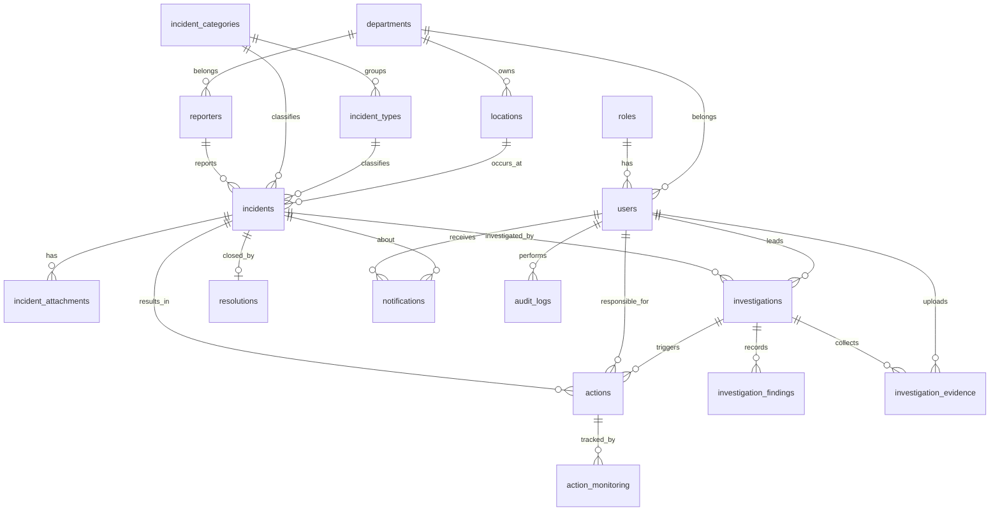

# Database Design (Labs 2-3, extended through Lab 20) — IndexedDB, 17 object stores

Every store has `id` (PK, auto-increment). `FK` = id of a row in another store. IndexedDB does not enforce foreign keys, so `DB.testRelations()` (shown on the Home page) checks every FK in `CONFIG.FKS`. Lookup tables (roles, departments, incident_categories, incident_types, locations) keep repeating values out of the main tables (3NF).

## ERD

## Data dictionary
| Store | Fields (besides id) | Keys / unique / indexes |
|---|---|---|
| roles | name | UNIQUE name |
| users | username, full_name, password_hash, role_id, department_id, active | UNIQUE username; FK role_id, department_id |
| departments | name, active | UNIQUE name |
| reporters | reporter_no, full_name, department_id, position, contact, email, address, reporter_type, status, created_at | UNIQUE reporter_no; FK department_id; idx reporter_type, status |
| incident_categories | name, description, active | UNIQUE name |
| incident_types | name, category_id, active | FK category_id |
| locations | name (built from building/floor/room/area), building, floor, room, area, department_id, description, status | UNIQUE name; FK department_id; idx status |
| incidents | incident_no, reporter_id, category_id, type_id, location_id, incident_date, incident_time, description, severity, immediate_response, status, date_reported | UNIQUE incident_no; FK reporter_id, category_id, type_id, location_id; idx severity, status, incident_date |
| incident_attachments | incident_id, file_name, file_type, file_data, uploaded_at | FK incident_id |
| investigations | incident_id, investigator_id, status, start_date, target_date, end_date, instructions, notes, assigned_at, assigned_by, rca{problem, immediate, cause, evidence, root, contrib, prevent} | FK incident_id, investigator_id(users); idx status |
| investigation_findings | investigation_id, finding, root_cause, contributing_factors, witnesses, evidence_summary, recommendation, created_at | FK investigation_id |
| investigation_evidence | investigation_id, description, file_name, file_type, file_data, uploaded_by, collected_at | FK investigation_id, uploaded_by(users) |
| actions | investigation_id, incident_id, action_type, description, assigned_to, due_date, priority, status | FK investigation_id, incident_id, assigned_to(users); idx status |
| action_monitoring | action_id, progress_note, percent_complete, checked_at | FK action_id |
| resolutions | incident_id, summary, resolved_by, resolved_at | UNIQUE incident_id (1 per incident) |
| notifications | user_id, incident_id, message, is_read, created_at | FK user_id, incident_id |
| audit_logs | user_id, entity, entity_id, action, details, created_at | FK user_id; idx entity |

## Enumerations
- severity: Low / Medium / High / Critical
- incident status: Open / Under Investigation / Resolved / Closed
- reporter_type: Employee / Student / Visitor / Contractor
- investigation status: Assigned → In Progress → Evidence Gathering → Findings Prepared → Completed
- action_type: Corrective Action / Preventive Action / Safety Improvement / Equipment Repair / Policy Improvement / Training / Process Improvement
- action status: Open / In Progress / Completed / Cancelled; priority: Low / Medium / High / Critical

## Notes
- Schema version 3 upgrades in place (no data loss): old locations get the new fields, and four demo users are seeded.
- Access control is role-based on the "Acting as" selector: only Admin and Investigator roles can assign investigations and view or upload evidence.
